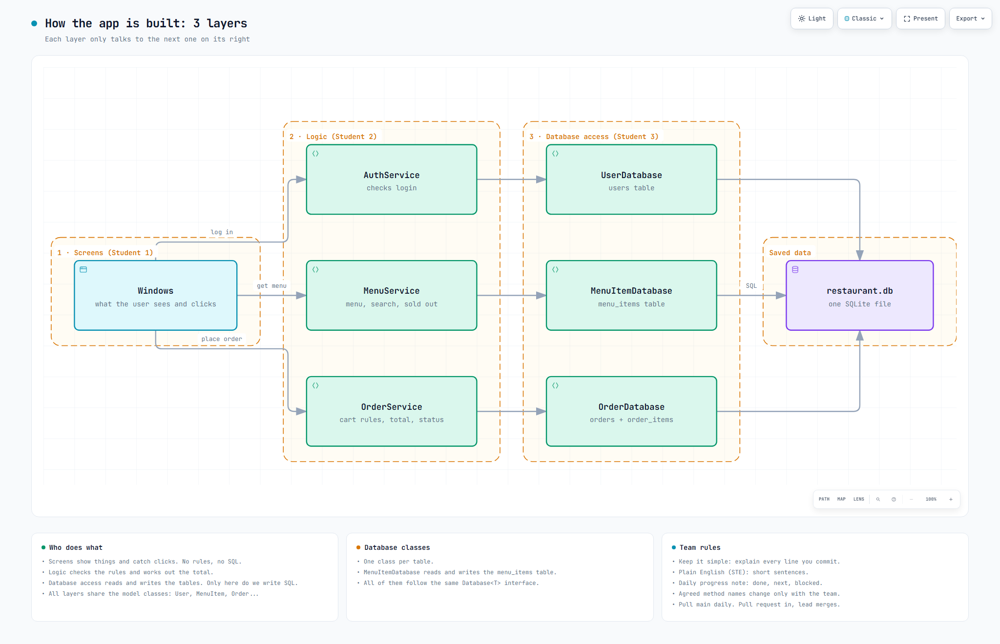
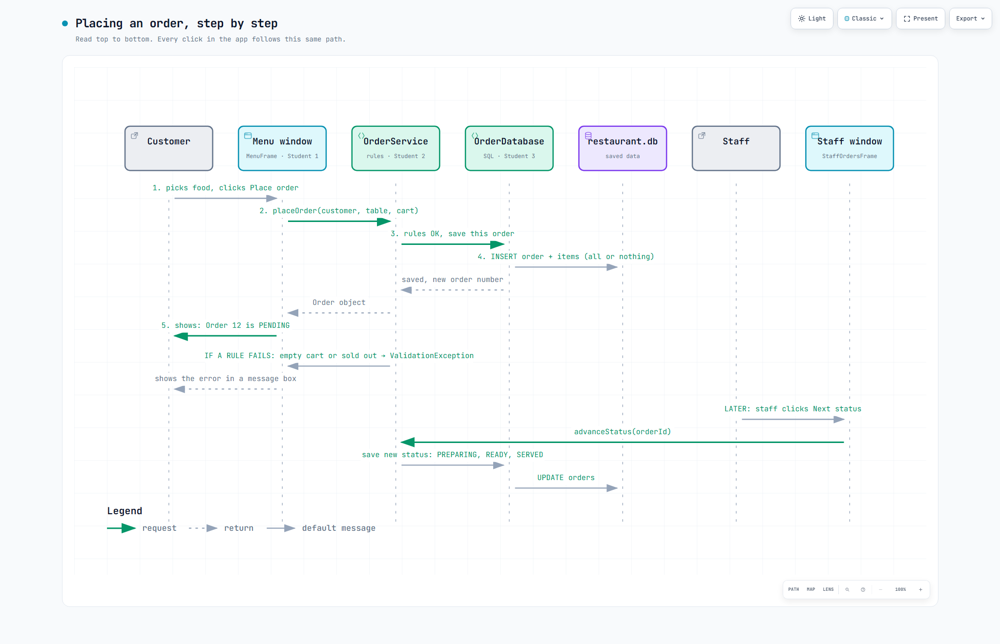

# How the app works

Start here. This page shows how the app fits together and who builds which part.
The details (exact method names, tables, deadlines) are in `docs/memory/plan.md`.
To see a diagram at full size, open the `.html` file in your browser. You can zoom in and switch to dark mode.

## 1. The big picture: 3 layers

Full size: `architecture/tiers.html`

The app is split into three layers, and each student owns one:

1. **Screens (Student 1).** The Swing windows. They show things and react to clicks. They contain no rules and no SQL.
2. **Logic (Student 2).** The service classes. They check the rules ("is the cart empty?") and work out
   things like the total price.
3. **Database access (Student 3).** The database classes (`UserDatabase`, `MenuItemDatabase`, `OrderDatabase`). They are the only place where we write SQL.

Each layer only talks to the layer next to it. A window never reads the database directly. It asks a
service, the service asks a database class, and that class runs the SQL.

Why we do this: each person can build their part on their own, and when something breaks we know where to look.
A wrong total is a logic bug. A missing row is a database bug. A button that does nothing is a screen bug.

## 2. One click, start to finish: placing an order

Full size: `architecture/place-order.html`

1. The customer picks some food and clicks **Place order**.
2. The menu window calls `orderService.placeOrder(customer, table, cart)`.
3. `OrderService` checks the rules. If they pass, it asks `OrderDatabase` to save the order.
4. `OrderDatabase` writes the order and its items to the database in one go. Either every row is saved, or none is.
5. The new order travels back up the layers, and the window shows "Order 12 is PENDING".

If a rule fails (the cart is empty, or an item is sold out), `OrderService` throws a `ValidationException`.
The window catches it and shows the message in a pop-up box.

Later, staff click **Next status** in their window. The order then moves through PREPARING, READY and SERVED.
It follows the same path: window → service → database class → restaurant.db.

Every feature in the app works this way. If you understand this one click, you understand the app.

## 3. Who builds what

| Student | Layer | Builds | Hands to the others |
| --- | --- | --- | --- |
| 1 (Ryan, lead) | Screens | wireframes, Swing windows, error pop-ups | the screen designs |
| 2 | Logic | the `model` classes, the services, the exceptions | the list of service methods |
| 3 | Database access | the tables, the SQL scripts, the database classes | the list of their methods |

Student 2 writes the `model` classes first, because all three layers use them.

How we work together (simple code, plain English, a daily progress note, pull requests) is in
`docs/memory/team-rules.md`. The short version is pinned on the diagram above.

## 4. Words you'll hear

| Word | What it means here |
| --- | --- |
| layer | One part of the app with one job. We have three. |
| service | A logic class, for example `OrderService`. It holds the rules. |
| database class | One class per table, for example `MenuItemDatabase` reads and writes the `menu_items` table. |
| model | A simple class that just holds data, like `MenuItem` (a name and a price). These objects get passed between the layers. |
| interface | A list of methods that a class promises to have. Every database class follows the `Database<T>` interface, so they all work the same way. |
| JDBC | The part of Java that sends SQL to a database. |
| SQLite | A database stored as one file (`restaurant.db`). It needs no server, so it runs on every laptop. |
| transaction | A group of database changes that are saved together, or not saved at all. |
| exception | An error object. Logic throws it, and the screen catches it and shows a message. |
