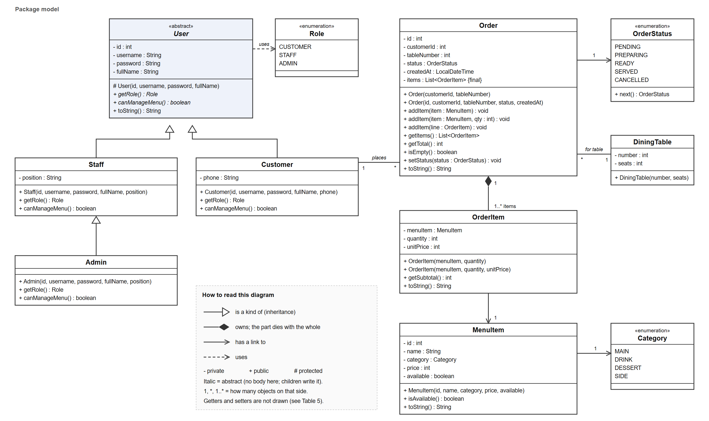
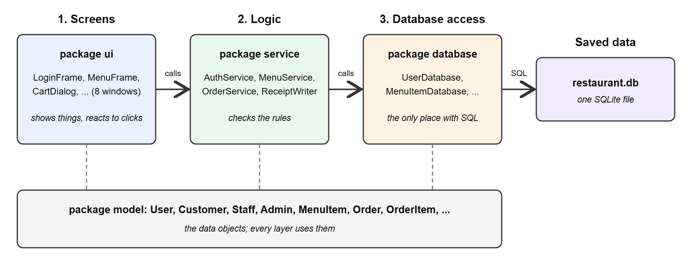
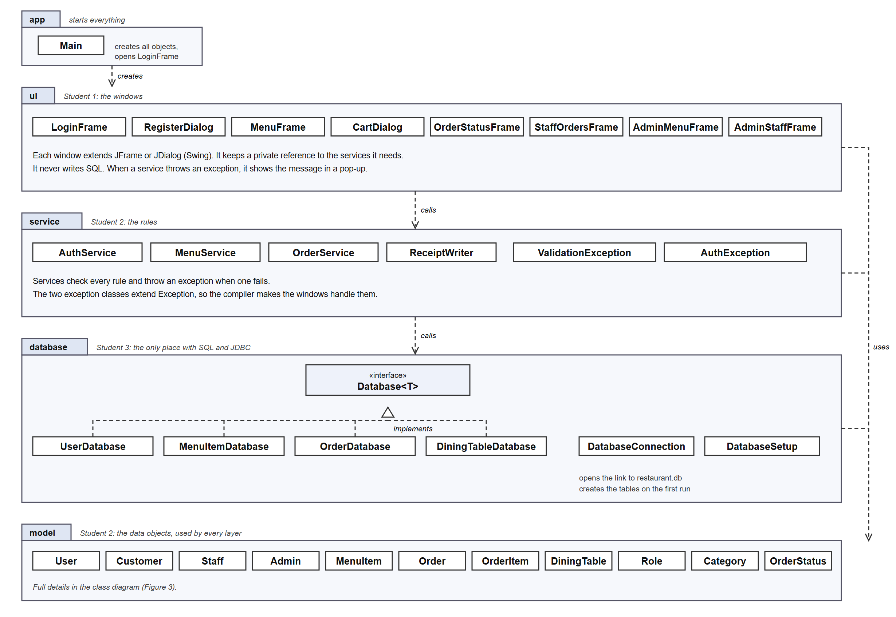

# Report skeleton: Assignment 2 (section III, Class Design)

Same content as the A2 tab in the team's Google Doc. The team writes in the Google Doc, not here.

## III. CLASS DESIGN

Text in [brackets] is a note for the writer. Replace it with your own words, then delete it.

### III.1 Classes



**Figure 3: Class diagram**

[Describe Figure 3 in 3 or 4 sentences. On the left are the people: User and its 3 children. On the right is ordering: an Order owns its OrderItems, and each OrderItem points to one MenuItem. Say why Order stores the customer and the table as numbers: that is how the database saves them.]

**Table 5: Details of classes**

| No | Class | Variables | Methods | Description |
| --- | --- | --- | --- | --- |
| 1 | User (abstract) | private int id, String username, String password, String fullName | protected constructor; getters; setters that check the value; abstract getRole(), abstract canManageMenu(); toString() | What every person has. Only the child classes call the constructor. |
| 2 | Customer extends User | private String phone | constructor; getPhone(), setPhone() checks 10 digits; getRole(), canManageMenu() | A guest who orders food. |
| 3 | Staff extends User | private String position | constructor; getPosition(), setPosition(); getRole(), canManageMenu() | A worker who runs the order queue. |
| 4 | Admin extends Staff | none | constructor; getRole(), canManageMenu() returns true | A staff member who also manages the menu and staff. |
| 5 | MenuItem | private int id, String name, Category category, int price, boolean available | constructor; getters; setPrice() checks price > 0; setAvailable(); toString() | One dish. The price is an int because VND has no decimals. |
| 6 | Order | private int id, customerId, tableNumber; OrderStatus status; LocalDateTime createdAt; final List<OrderItem> items | 2 constructors; 3 addItem() methods; getItems() gives a copy; getTotal(); setStatus(); toString() | One order for one table. |
| 7 | OrderItem | private MenuItem menuItem, int quantity, int unitPrice | 2 constructors; setQuantity() checks >= 1; getSubtotal(); toString() | One line of an order. It keeps the price from the time of the order. |
| 8 | DiningTable | private int number, int seats | constructor; getters; setSeats() checks > 0 | One table in the restaurant. |
| 9 | Role, Category, OrderStatus (enums) | fixed values | OrderStatus.next() gives the next step | Fixed lists: user kinds, dish types, order steps. |
| 10 | AuthService, MenuService, OrderService | private final reference to the database classes they use | login, register, placeOrder, advanceStatus, cancel, addItem, ... | The rules. They throw an exception when a rule fails. |
| 11 | ValidationException, AuthException | none | constructor(message) | Our two error types. |
| 12 | Database<T> (interface) and its 4 classes | none | findAll, findById, insert, update, delete | One class per table. The only classes with SQL. |
| 13 | The 8 windows (extend JFrame or JDialog) | private final services; private Swing fields | public constructor; private click handlers | The screens. They only call services. |

[One paragraph about Table 5. Say why every variable is private, why some are final, and why setters check values.]

### III.2 Abstract classes

**Table 6: Abstract classes**

| No | Abstract class | Abstract methods | Normal methods | Description |
| --- | --- | --- | --- | --- |
| 1 | User | getRole(), canManageMenu() | constructor, getters, setters, toString() | Parent of Customer, Staff and Admin. Nobody is "just a user", so we never write new User(...). |

[One paragraph. The normal methods are shared, so we write them once. The abstract methods force each child to give its own answer.]

### III.3 Overloading and overriding

Overloading: same method name, different inputs. Example from Order.java:

```java
public void addItem(MenuItem item) {
    addItem(item, 1);
}

public void addItem(MenuItem item, int qty) {
    items.add(new OrderItem(item, qty));
}

public void addItem(OrderItem line) {
    items.add(line);
}
```

[One paragraph. When is each version used? The first adds 1 dish, the second adds several, the third is used when an order is loaded from the database.]

Overriding: a child replaces a method it got from its parent. Example from Staff.java and Admin.java:

```java
public class Staff extends User {
    @Override
    public boolean canManageMenu() { return false; }
}

public class Admin extends Staff {
    @Override
    public boolean canManageMenu() { return true; }
}
```

[One paragraph. After login we call user.canManageMenu() without knowing the kind of user. Java runs the child's version, and that decides which window opens.]

### III.4 Inheritance

**Table 7: Inheritance we use**

| Technique | Where |
| --- | --- |
| extends | Customer and Staff extend User. Admin extends Staff. |
| abstract parent | User |
| super(...) calls the parent constructor | every child constructor |
| implements an interface | the 4 database classes implement Database<T> |
| extending Java classes | windows extend JFrame or JDialog; our errors extend Exception |

```java
public Customer(int id, String username, String password, String fullName, String phone) {
    super(id, username, password, fullName);
    setPhone(phone);
}
```

[One paragraph. Customer does not repeat the 4 shared variables; it gets them from User. super(...) must come first, because the parent part is built first.]

### III.5 The 3-tier model



**Figure 4: The three layers**

[One paragraph. Windows call only services. Services call only database classes. Only database classes use SQL. Give one example: placing an order.]

### III.6 Package design



**Figure 5: Packages and their classes**

**Table 8: Packages**

| Package | Job | Can use |
| --- | --- | --- |
| app | starts the app | all packages |
| ui | the windows | service, model |
| service | the rules | database, model |
| database | SQL and JDBC | model |
| model | the data objects | none of ours |

[One paragraph. The arrows only go down. model uses none of our packages, so it could be built first.]

### III.7 Access control

**Table 9: Data access control**

| Data | Class | Modifier | Why |
| --- | --- | --- | --- |
| username, password, fullName | User | private | Changed only through setters, which check the value. |
| phone | Customer | private | Personal data. The setter checks 10 digits. |
| price | MenuItem | private | Nobody can set it to 0 or less. |
| items | Order | private final | Only addItem() changes it. getItems() gives a copy. |
| URL | DatabaseConnection | private static final | One fixed value, used only by this class. |

**Table 10: Method access control**

| Method | Class | Modifier | Why |
| --- | --- | --- | --- |
| User(...) constructor | User | protected | Only the child classes call it. |
| getters, setters | model classes | public | Every layer needs them. |
| placeOrder(), login(), ... | services | public | The windows call them. |
| checkCart() | OrderService | private | A helper used only inside placeOrder(). |
| click handlers | windows | private | Only the window's own buttons use them. |

[One paragraph for each table. Our rule: start with private, and open it up only when another class needs it.]
